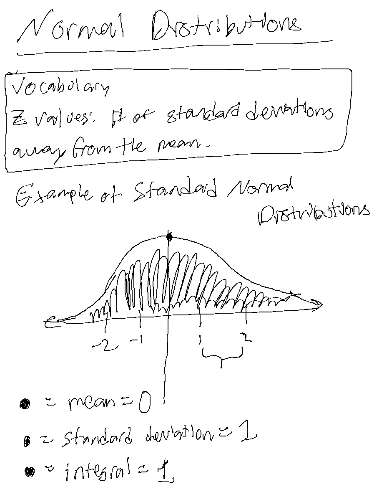
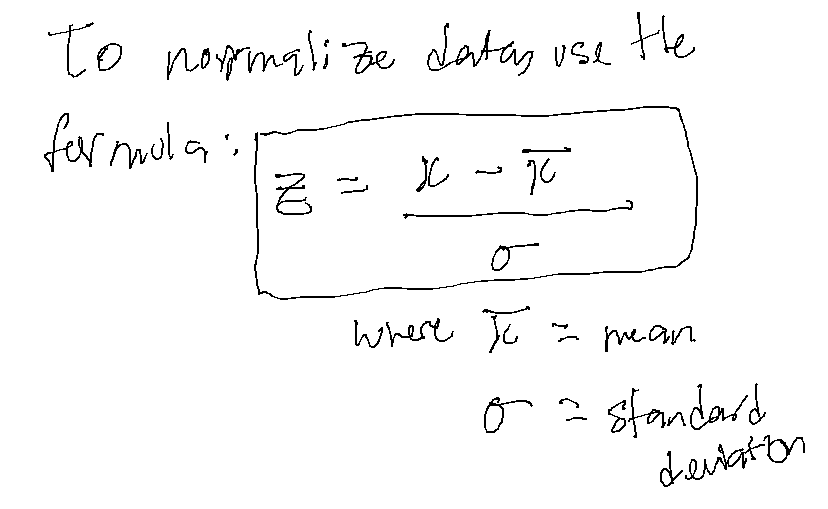

# About

Before 2016, there was an Android app called "Samsung S-Note". This was a note-taking app that used the stylus on Samsung phones and tablets to let users take notes.

Samsung S-Note was deprecated and removed from the Android Market. However, I still have several note files that were created using S-Note that I cannot open anymore. I am attempting to reverse-engineer the format of these notes so that I can access the contents from these notes now that no application supports them.

I've included my actual Samsung Note files (.spd extension) in the `note_files` directory.

# Code

There is a `spd_parser.py` that can decode the basic handwritten glyphs from note files.

Examples:

# SPD format

I've asked Claude to help me reverse-engineer the format of the SPD files. It created some documentation about the format, available in the `docs` directory.

